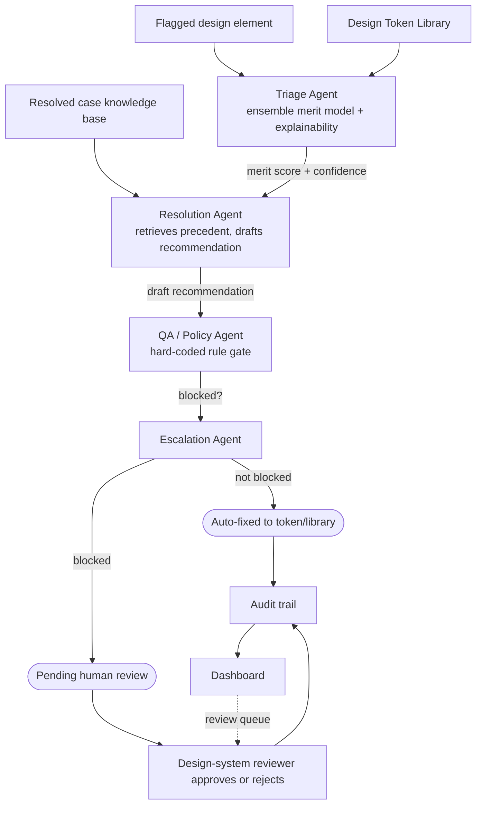

# DesignGuard — Agentic Design System Compliance Platform

Full write-up: see `docs/DesignGuard_Documentation.docx`

## How it works



## Quick start
```
pip install -r requirements.txt
python3 data/generate_data.py      # seed the database (900 elements, 607 precedent cases)
python3 train_model.py             # train the risk model (~0.65 ROC-AUC)
python3 -m app.main                # start dashboard -> http://localhost:8060
python3 -m unittest discover tests -v   # run all 20 tests
```

## Enabling the live Claude API integration
By default the Resolution Agent drafts recommendations deterministically (no
API key needed). To have Claude draft the recommendation and rationale instead:
```
pip install anthropic
export ANTHROPIC_API_KEY=your-key-here
python3 -m app.main
```
Falls back to the deterministic path automatically if the key is missing or
the call fails. See `app/llm_resolution.py`.

## Running the computer vision visual audit
Generates synthetic rendered frames and audits them directly from pixels
(color, corner radius, spacing) with OpenCV, independent of the metadata-based
pipeline above:
```
python3 run_visual_audit.py
```
Detected violations flow into the same design_elements table and the same
agent pipeline, tagged `detection_source = 'visual_cv'` so the dashboard can
show which detection path caught which violation.

## Why this exists
Built as a second application of the Triage/Resolution/QA/Escalation governance
pattern from PaymentGuard (payments fraud/disputes), this time applied to
design-system compliance — the exact kind of project Figma's own APM posting
names as an example ("design system features that improve adoption and
consistency at scale").

## Structure
- `data/generate_data.py` — synthetic design tokens, flagged elements, resolved-case knowledge base
- `train_model.py` — trains the ensemble merit model (RF + GB + LR)
- `app/agents.py` — Triage / Resolution / QA / Escalation pipeline
- `app/retrieval.py` — TF-IDF precedent retrieval
- `app/main.py` — Flask API + dashboard
- `tests/test_agents.py` — 12 unit tests
- `docs/architecture.png` / `.drawio` — system diagram
- `docs/DesignGuard_Documentation.docx` — full project write-up

## Honest limitations
No live Figma API connection (sandbox had no network access) — all data is
synthetic but modeled on Figma's real node/file structure. See the
documentation's Section 3.2 for the full, honest breakdown of what's
simulated versus what's real.
